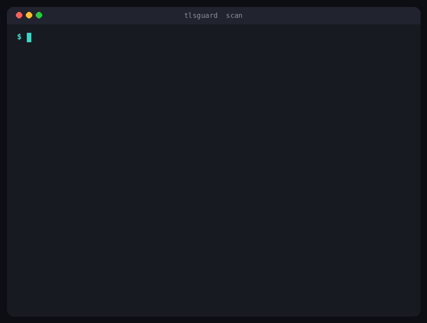

<div align="center">

# 🔐 TLSGuard

### Audit and harden the TLS posture of your endpoints.

TLSGuard connects to the servers you operate, inspects how their TLS is configured, and grades each one from A+ to F with clear findings and remediation. It checks certificates, protocol versions, cipher strength, forward secrecy, and HTTPS enforcement. One single, zero dependency Python tool that runs on your laptop, across a fleet, and in CI.


<br>



</div>

## Why TLSGuard

Most outages and downgrade attacks on transport security come from a handful of avoidable mistakes: a certificate that quietly expired, an old protocol left enabled, a cipher with no forward secrecy, or HTTPS that is never enforced. These are easy to miss and easy to fix once you can see them.

TLSGuard gives you that view in seconds. Point it at a host, and it tells you what is wrong, why it matters, and what to change. There is nothing to host and no account to create. It uses only the Python standard library, so there is no dependency tree to audit before you trust it on your infrastructure.

## What it checks

1. Certificate trust: whether the chain validates against the system trust store.
2. Expiry: how many days remain, with warnings before a certificate lapses.
3. Hostname coverage: whether the certificate actually covers the host.
4. Self signed certificates and unknown issuers.
5. Protocol versions from SSL 3.0 through TLS 1.3, so you can retire the old ones.
6. The negotiated cipher, and whether it is weak.
7. Forward secrecy, so a leaked key cannot unlock past sessions.
8. HTTPS enforcement through the Strict Transport Security header.

Each host gets a letter grade that starts at A+ and is capped down by each problem found.

## Install

With pipx, straight from the repository:

```bash
pipx install git+https://github.com/SiteQ8/TLSGuard.git
```

Or with pip from a clone:

```bash
git clone https://github.com/SiteQ8/TLSGuard.git
cd TLSGuard
pip install .
```

You can also run it without installing anything, since it uses only the standard library:

```bash
git clone https://github.com/SiteQ8/TLSGuard.git
cd TLSGuard
python -m tlsguard scan example.com
```

## Quick start

```bash
# audit a single host
tlsguard scan example.com

# audit a host on a custom port
tlsguard scan mail.example.com:8443

# audit several at once
tlsguard scan example.com api.example.com www.example.com

# audit a whole list from a file
tlsguard scan --from-file hosts.txt
```

## Usage

Machine readable output for tooling and dashboards:

```bash
tlsguard scan example.com --format json
```

Warn earlier about certificates that are about to expire:

```bash
tlsguard scan example.com --min-expiry-days 45
```

Audit a large fleet quickly, several hosts at a time:

```bash
tlsguard scan --from-file hosts.txt --concurrency 16
```

Skip parts of the audit when you only need the essentials:

```bash
tlsguard scan example.com --no-protocols --no-hsts
```

Fail the command when any host drops below a grade you set, which is what makes it useful in a pipeline:

```bash
tlsguard scan --from-file hosts.txt --fail-under B
```

## Grades

The grade reflects the worst problem found.

* **A+** valid trusted certificate, only TLS 1.2 and TLS 1.3, forward secrecy, and long lived HSTS.
* **A** the same, but HSTS is missing or short, or the certificate is close to expiry.
* **B** the connection lacks forward secrecy, or a certificate expires within your warning window.
* **C** an old protocol such as TLS 1.0 or TLS 1.1 is still enabled, or a weak cipher is in use.
* **F** the certificate is expired, self signed, untrusted, or does not match the host, or SSL 3.0 is enabled, or no modern TLS is available.

## Run it in CI

Catch an expiring certificate or a weak setting before your users do. This job runs on a schedule and fails if any endpoint drops below a B, which turns certificate expiry into a build failure instead of an outage:

```yaml
name: tls check
on:
  schedule:
    - cron: "0 7 * * *"
  workflow_dispatch:
jobs:
  tlsguard:
    runs-on: ubuntu-latest
    steps:
      - uses: actions/checkout@v4
      - uses: actions/setup-python@v5
        with:
          python-version: "3.12"
      - run: pip install git+https://github.com/SiteQ8/TLSGuard.git
      - run: tlsguard scan --from-file hosts.txt --fail-under B
```

## How it works

For each host, TLSGuard performs a normal TLS handshake, the same kind a browser does, and reads back what the server presents. It validates the certificate against the system trust store, decodes it to read the dates and names, negotiates a connection to learn the cipher, and opens one pinned connection per protocol version to see which are accepted.

When your local TLS library cannot offer an old protocol, TLSGuard reports that version as untested rather than guessing. This keeps the result honest. To confirm whether a server still accepts a very old protocol, run TLSGuard from a system where that protocol is enabled.

## Responsible use

TLSGuard is a client. It connects and reads what a server offers, the same as any browser or monitoring probe, and it does not attack, exploit, or send unusual traffic. Even so, scan only the endpoints you own or are authorized to assess. Point it at your own services and use it to make them safer.

## Exit codes

* `0` success, or no host fell below the grade set with `--fail-under`.
* `1` at least one host is below the grade set with `--fail-under`.
* `2` a usage problem, such as no targets given.

## Project layout

```
tlsguard/
├── tlsguard/
│   ├── cli.py         # command line interface
│   ├── audit.py       # connect, gather, and assemble a result
│   ├── protocols.py   # probe which TLS versions are accepted
│   ├── certs.py       # decode certificates, match hostnames, expiry
│   ├── grading.py     # findings and the letter grade
│   ├── report.py      # text and json output
│   └── models.py      # data models
├── tests/             # unit tests
├── examples/          # a sample targets file
└── docs/              # the demo
```

## Roadmap

See [ROADMAP.md](ROADMAP.md) for what is planned, including a certificate transparency check, weak cipher enumeration, and a watch mode for continuous monitoring.

## Contributing

Issues and pull requests are welcome. More checks, better remediation text, and more tests are all valuable. See [CONTRIBUTING.md](CONTRIBUTING.md) to get started.

## License

MIT. See [LICENSE](LICENSE). Free to use, change, and share.

<div align="center">

Built by [SiteQ8](https://github.com/SiteQ8). We build open source tools, agents, and technology.

If TLSGuard catches an expiring certificate for you, a star is welcome.

</div>
